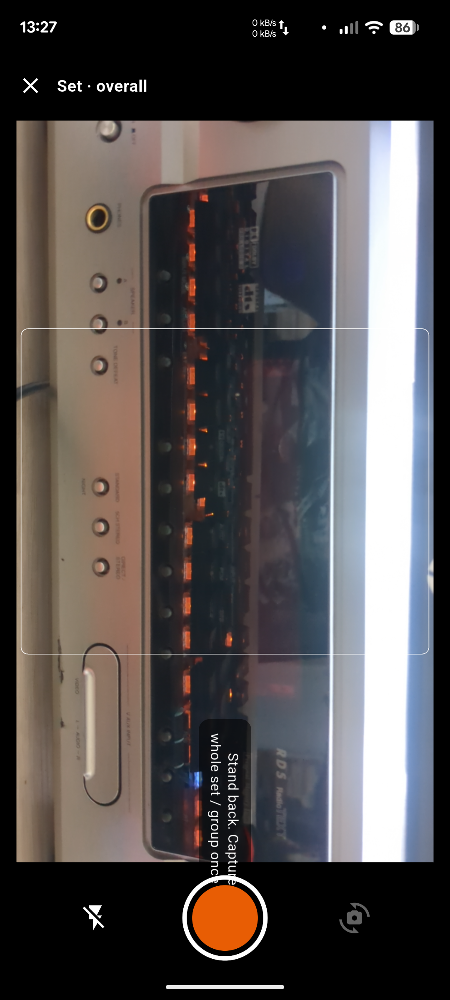
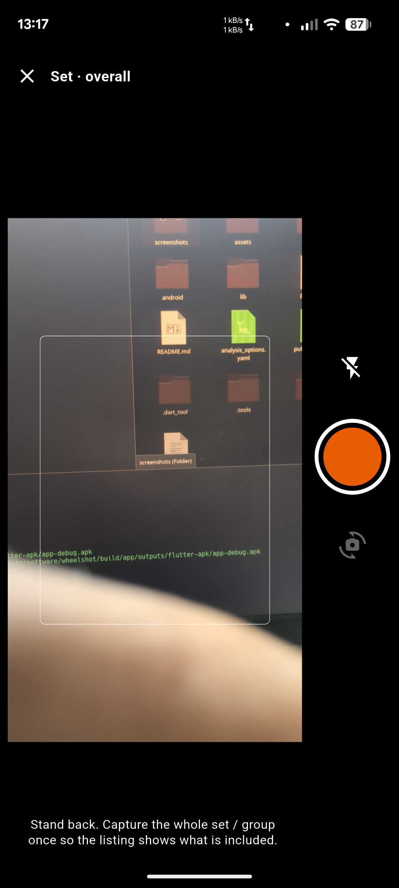
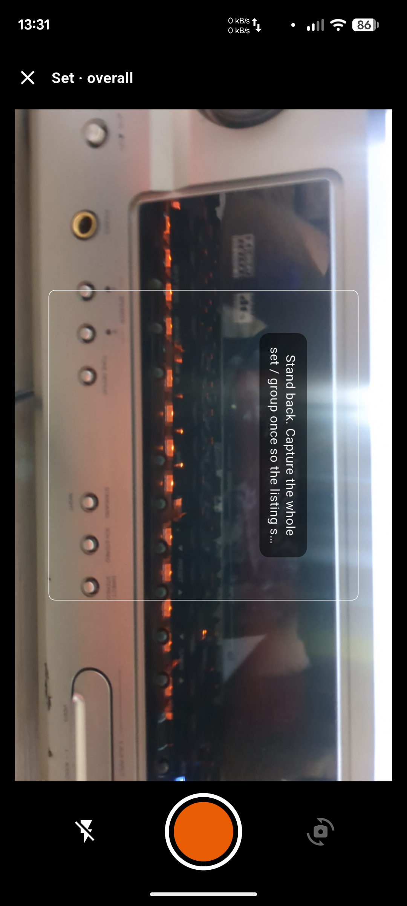

# WheelShot

Guided Android camera app for inventory photos of **tires and rims** — built for flipping wheels on marketplaces like Bazoš.

Point, shoot, fill specs. Sessions land as folders with ordered photos + JSON/text specs ready for listing.

<p align="center">
  
  
  
</p>

## Features

- **Shoot modes** — wheel set, rims only, tires only, or spare
- **Guided wizard** — required angles with on-screen frames + tips (overall, tread, DOT, stamps, size, ET)
- **Torch for close-ups** — DOT / brand stamp steps auto-enable flash
- **Specs dials** — PCD, center bore, rim size/ET, tire width/aspect/Ø (T/R/ZR), DOT week/year, XL/RFT
- **Diameter sync** — set rim or tire Ø once; unset pieces pick up the same size
- **Tire catalog** — common combos from real listings; width/aspect cascade picks usual mates
- **Edit past shoots** — reopen sessions from home, retake photos, tweak specs
- **Yay / nay** — confirm or retake after each capture
- **Local storage** — `Documents/WheelShot/<session>/` (photos + `specs.json` / `specs.txt`)

## Install

### Download APK

Every push to `main` builds a release APK and publishes it under [Releases](https://github.com/KodzghlyCZ/wheelshot/releases).

1. Open the latest **build-*** release (or a `v*` version tag)
2. Download `wheelshot.apk`
3. Install on Android (allow unknown sources if prompted)

### From source (USB)

```bash
git clone https://github.com/KodzghlyCZ/wheelshot.git
cd wheelshot
flutter pub get
flutter build apk --debug
adb install -r build/app/outputs/flutter-apk/app-debug.apk
```

Or use the helper script (host Flutter + Android SDK):

```bash
./scripts/build-apk.sh
```

Needs USB debugging on a physical phone (Camera2). Emulators work poorly for this app.

## Flow

1. Pick category + session name + piece count  
2. Wizard walks required shots  
3. Fill rim/tire specs (dials or pencil manual entry)  
4. Photos + specs sit in the session folder for listing / tooling  

### Required shots

| Piece | Shots |
|-------|--------|
| Tire | overall, tread/surface, DOT close-up, size marking |
| Rim | overall, brand stamp, size (e.g. 18×7½J), ET/offset |

## Camera

`ResolutionPreset.max`, focus lock on shutter, torch for DOT/stamp close-ups. Android Camera2 via `camera` + `camera_android`.

## CI

[`.github/workflows/release-apk.yml`](.github/workflows/release-apk.yml) runs on every push to `main`/`master` (and on `v*` tags / manual dispatch):

1. Flutter `3.47.5` + JDK 17  
2. `flutter build apk --release`  
3. Upload `wheelshot.apk` artifact  
4. Create a GitHub Release with the APK attached  

Tag a version for a non-prerelease release:

```bash
git tag v1.1.0
git push origin v1.1.0
```

## Project layout

```
lib/           Flutter app (screens, dials, session store)
assets/brand/  App branding
screenshots/   README captures
scripts/       Local build helpers
android/       Android host project
test/          Unit tests
```

## Non-goals

No OCR, cloud sync, photo editing, or iOS polish (yet).

## License

Private / all rights reserved unless otherwise noted.
